<!--

### C++ Developer · Systems Thinker · Builder

I’m **Shasheesh**, a computer science student building practical C++ projects—from data structures and algorithms to a console-based hospital management system.

[Projects](#-selected-projects) · [Skills](#-toolkit) · [Activity](#-contribution-signal) · [GitHub](https://github.com/shasheesh-tech)

---

## ⚡ Selected projects

| Project | What it is | Focus |
|---|---|---|
| [Hospital Patient Record System](https://github.com/shasheesh-tech/Hospital-patient-Record-system) | A console-based hospital workflow for patient records, doctors, appointments, billing, and symptom-based triage. | C++, OOP, file handling, STL |
| [DSL Programs](https://github.com/shasheesh-tech/DSL-programs) | A growing collection of data-structure implementations and coursework exercises, including trees, hashing, stacks, queues, and lists. | C++, data structures, algorithms |
| [C++ Practice](https://github.com/shasheesh-tech/cpp) | Smaller C++ exercises and experiments. | C++ fundamentals |
| **TrustGuardian AI** | An AI project focused on trust and protection. | AI |
| **FOCUS Study Helper** | A study helper built to support focused learning. | Education, AI |
| **AIMGOD LABX** | An AI-focused lab and experimentation project. | AI, experimentation |
| **StockSense** | A project focused on stock insights. | Finance, data |

> The hospital system is a team project. Its repository README lists the project team and describes the features and design.

> The four additional projects above are included as projects you’ve told me you built. They are not among the three public repositories currently listed on your GitHub account, so their names are shown without links until their repository URLs are available.

## 🧰 Toolkit

**Primary language:** C++  
**Practicing:** object-oriented programming, data structures and algorithms, STL, file handling, modular design, Git and GitHub

## 📡 Contribution signal

 

<a href="https://github.com/shasheesh-tech?tab=repositories">Explore all public repositories</a>

## 🌌 What I’m building toward

I enjoy turning concepts into working software: modeling a real workflow, choosing useful data structures, and making the pieces fit together. I’m continuing to grow my C++ foundations while taking on larger, more complete projects.

---

**Every system starts as an idea. I build until it works.**

Made with C++ and curiosity · <a href="https://github.com/shasheesh-tech">github.com/shasheesh-tech</a>

**shasheesh-tech/shasheesh-tech** is a ✨ _special_ ✨ repository because its `README.md` (this file) appears on your GitHub profile.

Here are some ideas to get you started:

- 🔭 I’m currently working on ...
- 🌱 I’m currently learning ...
- 👯 I’m looking to collaborate on ...
- 🤔 I’m looking for help with ...
- 💬 Ask me about ...
- 📫 How to reach me: ...
- 😄 Pronouns: ...
- ⚡ Fun fact: ...
-->
